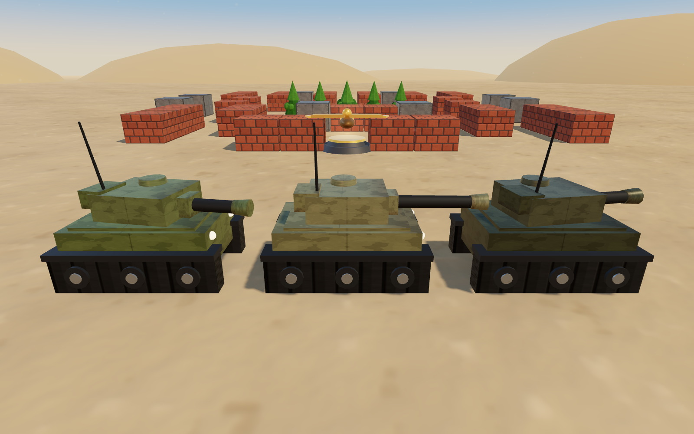
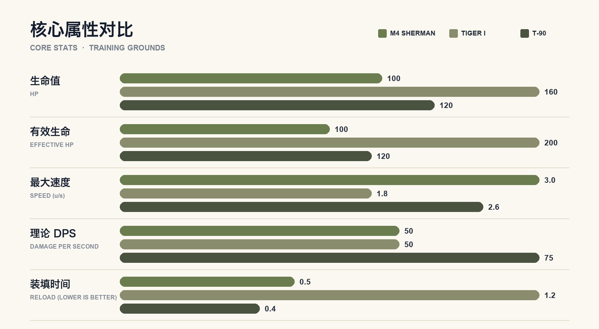
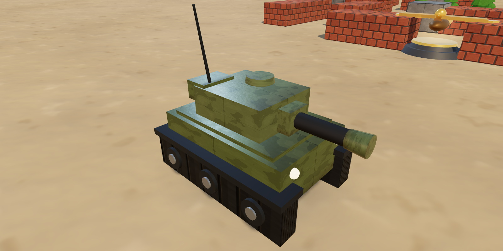
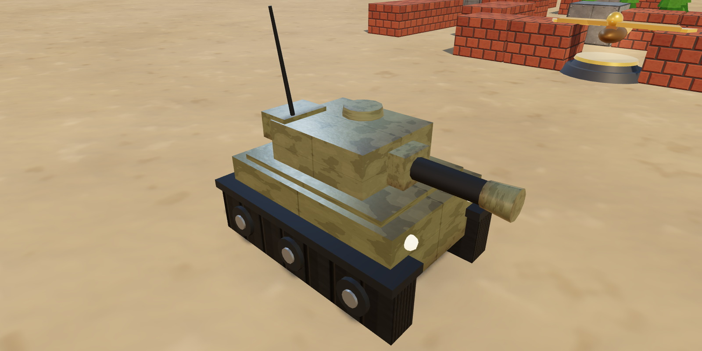
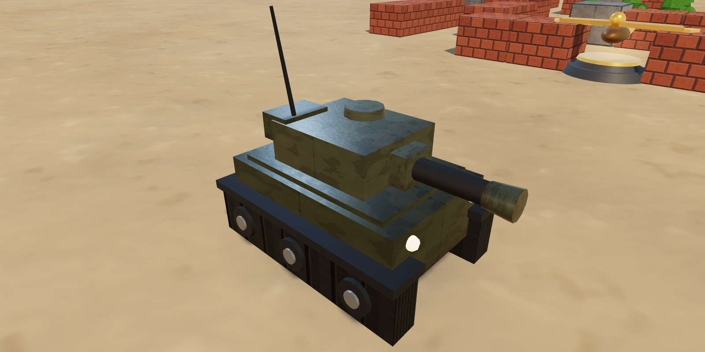
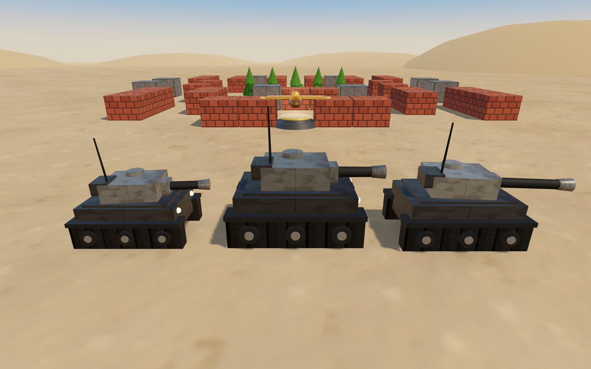
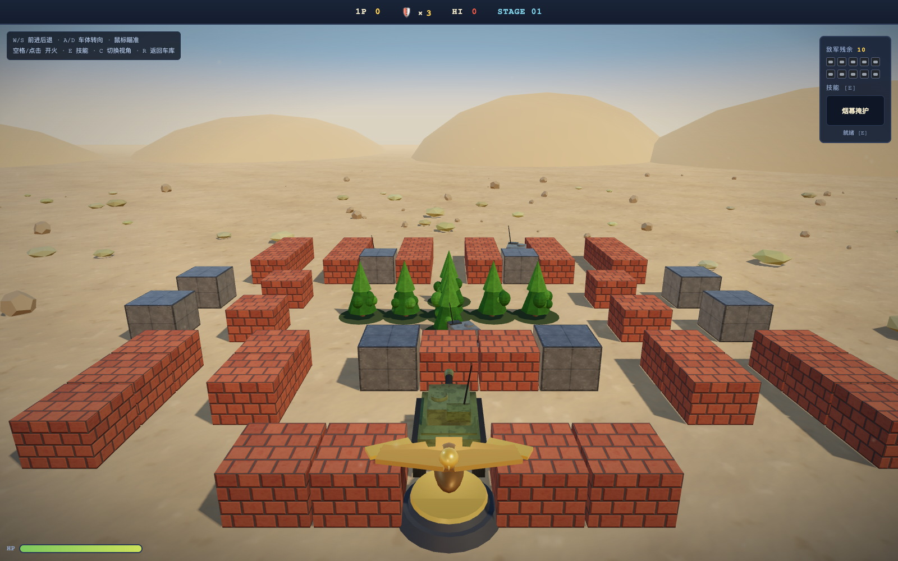
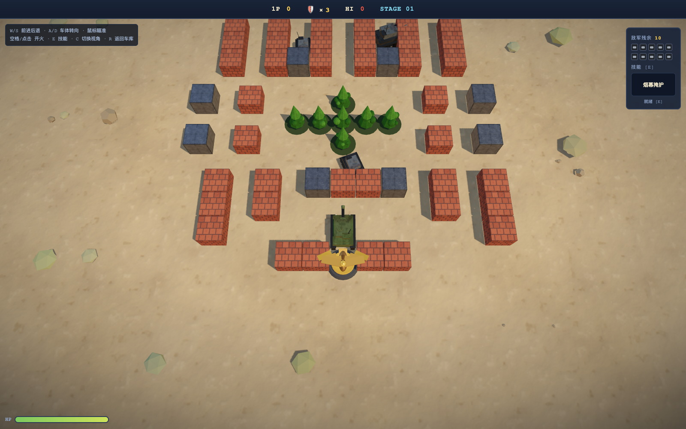
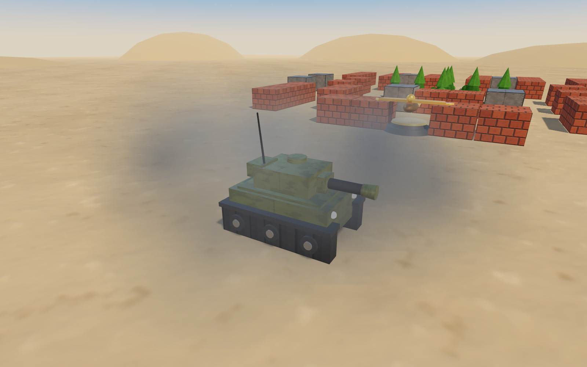

# 钢铁防线 3D · 坦克档案

> **STEEL BASTION 3D — TANK DOSSIER**  
> Training Grounds · Stage 01 · v1.0 / 2026.10

三台可驾驶坦克，三种敌军单位；所有属性取自游戏配置表 `index.html`，所有效果图均为游戏内实时渲染（1600×1000）。

*M4 Sherman、Tiger I、T-90 —— 同一片训练场上的三个时代*

---

## 目录

- [车辆概览](#车辆概览)
- [核心属性](#核心属性)
- [M4 Sherman](#m4-sherman)
- [Tiger I](#tiger-i)
- [T-90](#t-90)
- [敌军单位](#敌军单位)
- [战场与光影](#战场与光影)
- [操作与规则](#操作与规则)
- [数据说明](#数据说明)

---

## 车辆概览

三台车共用同一套驾驶、瞄准与开火逻辑，真正的差异在于装甲、机动、火力节奏，以及各自的一项战术技能。速度与弹速单位为 u/s（游戏内格/秒），转向单位为 rad/s。

| 属性 | M4 SHERMAN | TIGER I | T-90 |
|---|---|---|---|
| 定位 | 中型坦克 · 二战 | 重型坦克 · 二战 | 主战坦克 · 现代 |
| 生命值 | 100 | 160 | 120 |
| 有效生命 | 100 | 200（-20% 受击） | 120 + 3 次免伤 |
| 最大速度 | 3.0 u/s | 1.8 u/s | 2.6 u/s |
| 车体转向 | 2.8 rad/s | 1.6 rad/s | 2.4 rad/s |
| 装填时间 | 0.50 s | 1.20 s | 0.40 s |
| 单发伤害 | 25 | 60 | 30 |
| 弹速 | 9 u/s | 10 u/s | 12 u/s |
| 理论 DPS | 50 | 50 | 75 |
| 技能 | 烟幕掩护 · 20s | 穿甲弹 · 15s | 反应装甲 · 25s |
| 特性 | 拾取补给后自修 5s | 受到伤害 -20% | 森林敌军不隐身 |

> 有效生命 = 生命值 ÷ (1 - 减伤)。表中 DPS = 单发伤害 ÷ 装填时间，未计入穿甲弹与烟幕带来的输出窗口。

### 定位速览

| 坦克 | 定位 | 一句话 |
|---|---|---|
| M4 Sherman | 机动 · 均衡 | 烟幕开道，持续游走 |
| Tiger I | 重装 · 攻坚 | 正面推进，一炮破墙 |
| T-90 | 速射 · 视野 | 最高 DPS，反伏击 |

**怎么选：** 要节奏与烟幕选 Sherman；要正面攻坚选 Tiger I；要射速与反伏击选 T-90。

---

## 核心属性

*图 1 · 三台坦克的核心属性对比*

三台车形成了清晰的三角关系：Sherman 用机动和射速换取持续输出与烟幕窗口；Tiger I 用速度换装甲和单发爆发；T-90 则以最高 DPS、反应装甲和反伏击观瞄成为最稳的持续火力平台。

---

## M4 Sherman

> **中型坦克 · 二战 · 均衡型**

*图 2 · M4 Sherman 战场渲染*

| 指标 | 数值 | 指标 | 数值 |
|---|---:|---|---:|
| 生命值 | **100** | 最大速度 | **3.0 u/s** |
| 装填时间 | **0.50 s** | 单发伤害 | **25** |
| 弹速 | **9 u/s** | 理论 DPS | **50** |

> **技能 [E] · 烟幕掩护**　冷却 20 秒  
> 释放烟幕 5 秒，敌方 AI 无法锁定你。烟幕会同时遮断视线与射击，可用来强行穿越开阔地、掩护撤退或拆解狙击车的射界。

*提示：拾取任意补给后，Sherman 还会获得 5 秒自修（约 +10 HP）。*

### 战术定位

三车中最均衡的一台。3.0 u/s 的速度与 0.5 秒装填让它能持续游走、快速补位；25 点单发伤害偏低，面对 75 HP 的主战线车需要连续命中。烟幕既能掩护撤退，也能遮断狙击车的射界；每次拾取补给还会触发 5 秒自修（约 +10 HP），续航是三车中最好的。

| 优势 | 注意 |
|---|---|
| 机动灵活，射速快，烟幕可攻可守，续航好 | 单发伤害低，破墙效率一般，正面换血吃亏 |

---

## Tiger I

> **重型坦克 · 二战 · 攻坚型**

*图 3 · Tiger I 战场渲染*

| 指标 | 数值 | 指标 | 数值 |
|---|---:|---|---:|
| 生命值 | **160** | 有效生命 | **200** |
| 装填时间 | **1.20 s** | 单发伤害 | **60** |
| 弹速 | **10 u/s** | 理论 DPS | **50** |

> **技能 [E] · 穿甲弹**　冷却 15 秒  
> 下一炮击穿钢墙，并贯穿最多 2 个敌人。适合在僵持线上直接拆掉钢板掩体，或对准一条直线上的敌军制造双杀。

*提示：Tiger I 受到的所有伤害额外 -20%，有效生命约 200。*

### 战术定位

以装甲和单发伤害换机动的重装平台。160 HP 配合 20% 受击减免，实际可承受约 200 点伤害；60 点单发伤害两炮即可摧毁主战线车。1.2 秒装填意味着每一次开火都要有把握，穿甲弹则提供了击穿钢墙、贯穿最多 2 个敌人的破阵能力。

| 优势 | 注意 |
|---|---|
| 有效生命最高，单发爆发强，穿甲弹可破墙/贯穿 | 装填慢、转向慢，侧翼被绕时很难脱身 |

---

## T-90

> **主战坦克 · 现代 · 速射 / 视野型**

*图 4 · T-90 战场渲染*

| 指标 | 数值 | 指标 | 数值 |
|---|---:|---|---:|
| 生命值 | **120** | 最大速度 | **2.6 u/s** |
| 装填时间 | **0.40 s** | 单发伤害 | **30** |
| 弹速 | **12 u/s** | 理论 DPS | **75** |

> **技能 [E] · 反应装甲**　冷却 25 秒  
> 吸收接下来 3 次伤害（30 秒内）。可以主动探头换血、吃掉狙击车的首发，或在冲锋时抵消一轮交叉火力。

*提示：T-90 的观瞄不受森林遮蔽影响，林中的敌军不会进入半透明隐身状态。*

### 战术定位

现代主战平台，用射速与观瞄换取容错。0.4 秒装填带来 75 点理论 DPS，是三车中最高的持续输出；120 HP 配合 3 层反应装甲，可以主动吃下 3 次伤害。它的观瞄优势让森林中的敌军不再进入隐身状态，反伏击能力最强。

| 优势 | 注意 |
|---|---|
| DPS 最高，反应装甲可主动换血，反伏击 | 单发低，装甲层数有限，技能冷却较长 |

---

## 敌军单位

敌军由三种车体轮换组成，每波最多同时存在 4 辆，三波共 10 辆。生命值以 25 点为一档，表中同时给出档位与原值。

| 单位 | 生命 | 速度 | 射击间隔 | 伤害 | 射程 | 分值 | 行为特征 |
|---|---:|---:|---:|---:|---:|---:|---|
| **Scout 侦察车** | 25（1） | 3.6 | 1.5 s | 10 | 5 | 100 | 0.8× 车体；未锁定时左右绕行搜索 |
| **Line 主战线车** | 75（3） | 1.6 | 2.0 s | 20 | 7 | 200 | 1.0× 车体；直线推进，持续压制 |
| **Sniper 狙击车** | 50（2） | 2.2 | 2.5 s | 30 | 9 | 300 | 0.9× 车体；长身管，0.55 s 瞄准，高精度 |

*图 5 · 从左至右：Scout、Line、Sniper*

### 行为逻辑

- 敌军优先追击玩家；失去视线后改向鹰徽推进，形成“逼你回防”的压力。
- 狙击车在 4.2 格内会后撤，在 4.2—9 格之间停车瞄准；0.55 秒瞄准后以极小误差射击。
- 侦察车没有目标时会左右摆动搜索；被卡住 0.35 秒后尝试 90° 转向脱困。
- 敌军进入森林会变为半透明；T-90 的观瞄不受影响。敌方炮弹速度为 7.5 u/s。

---

## 战场与光影

当前版本对场景做了一次完整的渲染升级：天空、材质、阴影和粒子全部程序化生成，不依赖任何外部贴图。

*图 6 · 战斗视角：追尾镜头、沙地、砖墙与鹰徽*

| 俯视视角 | 烟幕掩护 |
|---|---|
|  |  |
| *图 7 · 俯视视角* | *图 8 · 烟幕掩护技能* |

### 渲染要点

- **天空与 IBL**：程序化天空 + 太阳光晕生成 PMREM 环境贴图，金属与车体都有真实反射。
- **PBR 材质**：沙地、砖墙、钢板、迷彩与履带均带 albedo / normal / roughness 贴图。
- **阴影**：2048 PCF 软阴影 + 车底接触阴影；主光、补光、轮廓光与半球光四层布光。
- **物理反馈**：炮管后坐、履带滚动、扬尘、履带印、炮口硝烟与爆炸点光源。
- **性能**：1440×900 下约 60 FPS，材质与特效按战斗生命周期释放。

---

## 操作与规则

### 操作

| 操作 | 按键 |
|---|---|
| 前进 / 后退 | `W` / `S` |
| 车体转向 | `A` / `D` |
| 炮塔瞄准 | 鼠标 |
| 开火 | `空格` / 鼠标左键 |
| 技能 | `E` |
| 切换视角 | `C`（追尾 / 俯视） |
| 返回车库 | `R` |

### 规则

- 守住底部鹰徽；任何炮弹——包括你自己的——命中鹰徽即告失败。
- 三波敌军共 10 辆，波次在 0 / 15 / 30 秒触发，场上同时最多 4 辆。
- 玩家 3 条命；阵亡 1.5 秒后重生，重生后 2.5 秒无敌。
- 击毁得分：侦察车 100 / 主战线车 200 / 狙击车 300；拾取补给 +500；最高分写入浏览器 localStorage。

### 补给

| 补给 | 效果 |
|---|---|
| **★ Star** | 射速提升：装填时间 ×0.7（最低 0.22 s），并 +500 分 |
| **Grenade** | 立即摧毁场上所有敌军，+500 分 |
| **Shovel** | 鹰徽周围砖墙临时加固 15 秒，+500 分 |
| **Clock** | 全场敌军冻结 8 秒，+500 分 |
| **Helmet** | 能量护盾 10 秒，+500 分 |
| **Tank** | 备用坦克 +1 |

> 补给由被击毁的敌军以 22% 概率掉落，12 秒后消失。M4 Sherman 拾取任意补给后额外获得 5 秒自修。

---

## 数据说明

- 坦克、敌军、补给与规则数据来自 `index.html` 的 `TANKS` / `ENEMY_TYPES` / `POWERUPS` 配置。
- 效果图为游戏内实时渲染，分辨率 1600×1000，Three.js r160，ACES 色调映射，程序化 PBR 材质。
- v1.0 · 2026.10：场景光照与材质重制；补齐坦克 id 后，烟幕掩护、穿甲弹与反应装甲技能全部生效；坦克履带增加负重轮与履带板细节。
- Word 版：[钢铁防线3D_坦克档案.docx](钢铁防线3D_坦克档案.docx)（9 页，同一套内容与图片）。
- 图片素材：[docs/assets](assets/)。

*文档版本 v1.0 · 2026.10*
