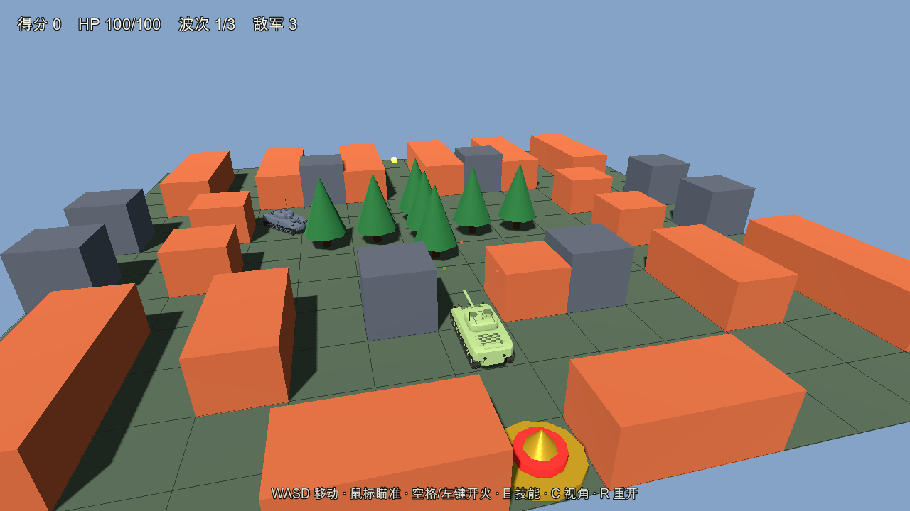
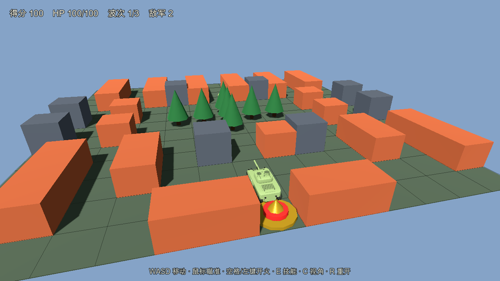
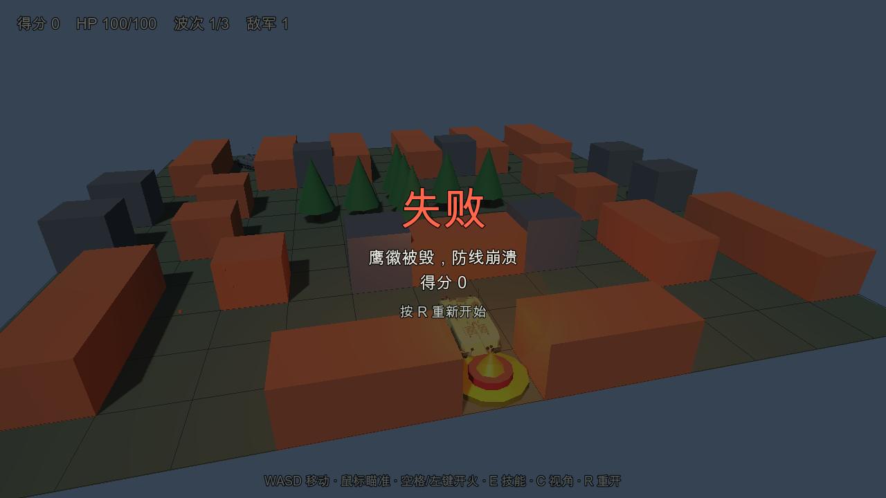

# 移植可行性验证报告（Pilot）

- 日期：2026-10-20
- 源：`versions/v3`（3.0.0，v2 的完整复制）
- 目标：Godot 4.7.1，`gl_compatibility`
- 范围：G0 基线 → G1 契约/黄金 trace → G2 工程骨架 → G3 内核回放 → **G4 视觉纵切片** → GLB 资产契约
- 不在本轮范围：G5 全内容表现、G6 完整 HUD/音频/性能、G7 导出

## 结论

**SOP 有效，核心与首个可玩切片都已跑通。** 718 行 JS 规则内核在 Godot 里以 721 行
GDScript 重建；10 项规则测试、5 条黄金回放、2 个 GLB 资产契约全部通过。G4 已经能
用真实 GLB、真实关卡、真实鼠标/键盘打一局：移动、开火拆砖、击杀敌人、鹰徽失败结算。

契约法在**写画面之前**抓到了三个真实问题：

1. 源 `spawn` 事件的 payload `type` 覆盖了事件 type，`case 'spawn'` 永远不命中
   （源侧潜在 bug，出生特效实际不会播放）。
2. JSON 传输十进制 `dt` 在 Godot 里差 1 ULP，导致 `spawnTimer` 在边界上差一帧。
3. Godot 的 `Color.hex(int)` 把源里的 `0xRRGGBB` 当成 `0xRRGGBBAA` 读，涂装变成
   青色半透明；改用 `Color8` 拆三通道后恢复橄榄绿。

这三类问题如果按“先做画面、边看边调”的方式移植，通常要等到 G4 才以“特效怎么不出现”
“敌人晚一帧出生”“坦克颜色怎么是青的”的形式暴露，定位成本高得多。

## 结果

| 门禁 | 内容 | 结果 | 证据 |
|---|---|---|---|
| G0 | v3 测试、源哈希、资产哈希 | **通过** | `port/evidence/G0/tests.txt`、`port/source-manifest.sha256` |
| G1 | 内容契约、5 条 trace、双跑确定性 | **通过** | `port/contract/`、`port/traces/`、`port/evidence/G1/` |
| G2 | Godot 工程导入、脚本编译、GLB 实机渲染 | **通过（有画面）** | `port/evidence/G2/import.txt`、`port/evidence/G2/tank.png` |
| G3 | 10 项规则测试 + 5 条 trace 回放 | **通过** | `port/evidence/G3/godot-tests.txt` |
| C5 | hero/troop 的 tag、clip、LOD | **通过** | 同上（TestAsset 输出） |
| G4 | 真实场景、TankRig、追尾相机、开火/拆砖、击杀、鹰徽失败 | **通过** | `port/evidence/G4/` |
| G5–G7 | 全内容/HUD/音频/导出 | 未执行 | 下一阶段 |

### G3 明细

规则测试（10 项，全部 PASS）：

- 内容完整性、砖块阻挡、开火拆砖、敌人伤害、护盾、鹰徽失败、清波胜利、Star 道具、
  同 seed 确定性、core 纯净性。

黄金回放（5 条，全部 PASS）：

| 场景 | 步数 | 事件 | 结果 |
|---|---|---|---|
| `drive_into_brick` | 120 | 3 | PASS |
| `fire_brick` | 120 | 6 | PASS |
| `hit_enemy` | 300 | 12 | PASS |
| `eagle_fail` | 120 | 6 | PASS |
| `skill_smoke` | 180 | 6 | PASS |

资产契约：

- hero：199 个 `MeshInstance3D`，146 个 `AnimLink_` 履带板，`Drive` + `Fire`，3 个 tag 全在。
- troop：9 个 `MeshInstance3D`，0 个履带板，只有 `Fire`，3 个 tag 全在。

### G4 明细

已实现：

- `TankRig`：GLB 实例化、tag 查找、`scale=0.22`、涂装、`Drive` 循环 + `Fire` 单次、
  炮塔/炮管、受击闪色、履带/轮子关阴影。
- 13×13 世界：砖/钢/水/森林/冰/鹰徽、地面网格、`tileChanged` 即时更新、拆砖碎片。
- 追尾相机：肩部偏移、跟随、C 键切俯视；鼠标射线打地面 → `aim_at`。
- 炮弹视图、炮口焰、爆炸、HUD（得分/HP/波次/敌军/提示/结算）。
- 输入：WASD、鼠标瞄准、空格/左键开火、E 技能、C 视角、R 重开。
- 源 `spawn` bug 兼容：同时接受 `type=spawn`（修源后）和 `type=scout/line/sniper`
  （当前源）两种事件形状。

自动验证（`--autotest` / `--combat` / `--eagle`）：

| 模式 | 结果 |
|---|---|
| `--autotest` | `phase=battle`，砖块 `(9,6)` 被摧毁（`tile9_6=0`），3 个敌人 |
| `--inputtest` | 真实 `Input.action_press("move_forward")` 驱动，`z≈3.90`，`moved=true` |
| `--combat` | `score=100`，`killed=1`，剩余 2 个敌人，砖块已拆 |
| `--eagle` | `phase=lost`，结算浮层显示“失败 / 鹰徽被毁，防线崩溃” |







画面仍是**原型级**：砖块/钢墙是纯色 BoxMesh，森林是圆锥，爆炸是简单球体，没有贴图、
音频、车库和完整特效。G4 的目标是“规则 + 资产 + 输入 + 相机 + HUD 全链路可玩”，不是
最终美术。

## 关键发现

### 1. 源 `spawn` 事件被 payload 覆盖（源 bug）

源：

```js
const emit = (type, data = {}) => events.push({ type, ...data });
emit('spawn', { id, type: typeId, x, z, scale });
```

`type` 在展开时被 `typeId` 覆盖，事件实际变成 `"scout" / "line" / "sniper"`。
`app/game.js` 的 `switch (event.type) { case 'spawn': ... }` 因此永远不执行，
出生特效实际缺失。

处理：

- Godot 核心按 JS 展开顺序复现，保证 trace 一致（`_emit` 先写 `type`，再覆盖 payload）。
- G4 视图同时兼容两种形状：`type` 是敌人类型，或 `type=spawn` + `enemyType`。
- **建议在源侧修复**：payload 改名 `enemyType`，同步 `view` 与 trace。见 `DEVIATIONS.md` D001。

### 2. `dt` 不能用十进制跨引擎传输（新 SOP 规则）

第一轮 trace 中 `drive_into_brick / fire_brick / skill_smoke` 都差一帧，原因不是规则，
而是 `dt: 0.016666666666666666` 在 Godot JSON 解析后比 `1.0/60.0` 小 1 ULP，
60 次累加后 `spawnTimer` 从 `-1.39e-15` 变成 `+1.89e-15`，第二次刷怪从第 60 步推到第 61 步。

修复：trace 增加 `dt_num: 1, dt_den: 60`，回放用 `float(dt_num)/float(dt_den)` 在目标引擎
重新计算。修复后 5/5 通过。

### 3. `Color.hex(int)` 把 RGB 当 RGBA

源涂装是 `0x7a8b56`（RGB）。Godot 4.7 的 `Color.hex(0x7a8b56)` 按 `0xRRGGBBAA` 解释，
得到 `(0, 0.478, 0.545, 0.337)` —— 青色半透明。改用：

```gdscript
var v := int(paint[key])
copy.albedo_color = Color8((v >> 16) & 0xFF, (v >> 8) & 0xFF, v & 0xFF)
```

这是“颜色数字跨引擎”的典型坑，已写进 skill。

### 4. `tr` 是 Godot `Object` 的保留方法名

`PortConstants.tr()` 与 `Object.tr()` 冲突，Godot 直接报 “overrides a method from native class”。
已改名 `row_at()` / `col_at()`。这是命名层面的坑，不影响契约。

### 5. 资产契约与 manifest 完全一致

`troop` 没有 `Drive` 得到验证；`TankRig` 允许 `clips.drive = null`。
hero 146 节履带在 Godot 里就是 146 个节点/潜在 draw call，G6 的性能优化点被提前确认。

### 6. 规则层可以直接对照移植

JS 718 行 → GDScript 721 行；函数、字段、更新顺序一一对应。没有用 Godot 物理、
没有用 `Vector2/Vector3` 存权威数值、没有用 signal 发事件。10 项测试一次性通过
（除 `dt` 问题外，规则本身没有返工）。

## 工作量观察

本轮（G0–G4）在一个会话内完成，主要时间花在：

- 写导出/录像脚本与 5 条 trace；
- 718 行核心的逐函数移植；
- 三个边界问题的定位（事件展开、`dt` ULP、`Color.hex`）；
- G4 场景/相机/HUD 的第一版接线。

这支持原估算：完整 P1 移植约 10–16 个工作日；G3 是最值得先做、也最适合用黄金 trace
锁死的部分；G4 之后主要是表现与内容工作量，规则风险已经很低。

## 下一阶段建议

1. **先定 D001**：修源 `spawn` payload，还是接受出生特效缺失。推荐修源。
2. **G5 全内容**：3 辆坦克、3 类敌人、3 波 10 辆、6 种道具、技能/生命全路径；
   把车库/选车补上（当前 G4 直接进战斗）。
3. **G6 表现/性能**：砖/钢贴图、森林/水面材质、粒子爆炸、音效烘 WAV、完整 HUD；
   先测 146 节履带的 draw call，再决定 MultiMesh/合并。
4. **G7 导出**：先桌面，再评估 Web（`gl_compatibility` 已从第一天启用）。

## 产物

```
godot/                          # 可运行的 Godot 4.7 工程（G0–G4）
  game.tscn / game.gd           # 可玩切片：场景、相机、输入、HUD、事件接线
  view/tank_rig.gd              # GLB → 炮塔/炮管/炮口/Drive/Fire/涂装
  core/{constants,rng,grid,battle}.gd
  content/{content.json,content_db.gd}
  tests/{TestRunner.tscn,TestCore.gd,TestTrace.gd,TestAsset.gd,golden/*.json}
  assets/models/*.glb
port/
  BASELINE.md  CONTRACT.md  PILOT.md  PARITY.md  DEVIATIONS.md  port-manifest.json
  contract/content.json
  traces/*.json
  tools/{export_content.mjs,record_trace.mjs}
  evidence/{G0,G1,G2,G3,G4}/
```

复跑：

```bash
# 源测试
cd versions/v3 && npm test && cd ../..

# 重新导出契约与 trace
node port/tools/export_content.mjs versions/v3 port/contract
node port/tools/record_trace.mjs versions/v3 port/traces port/contract/content.json

# Godot 导入 + 规则/资产/trace 测试
HOME=/tmp/godot-home godot --headless --path godot --import
HOME=/tmp/godot-home godot --headless --path godot res://tests/TestRunner.tscn

# G4 自动截图（打开窗口，写 port/evidence/G4/）
HOME=/tmp/godot-home godot --path godot res://game.tscn --rendering-driver opengl3 -- --autotest
HOME=/tmp/godot-home godot --path godot res://game.tscn --rendering-driver opengl3 -- --inputtest
HOME=/tmp/godot-home godot --path godot res://game.tscn --rendering-driver opengl3 -- --combat
HOME=/tmp/godot-home godot --path godot res://game.tscn --rendering-driver opengl3 -- --eagle
```
