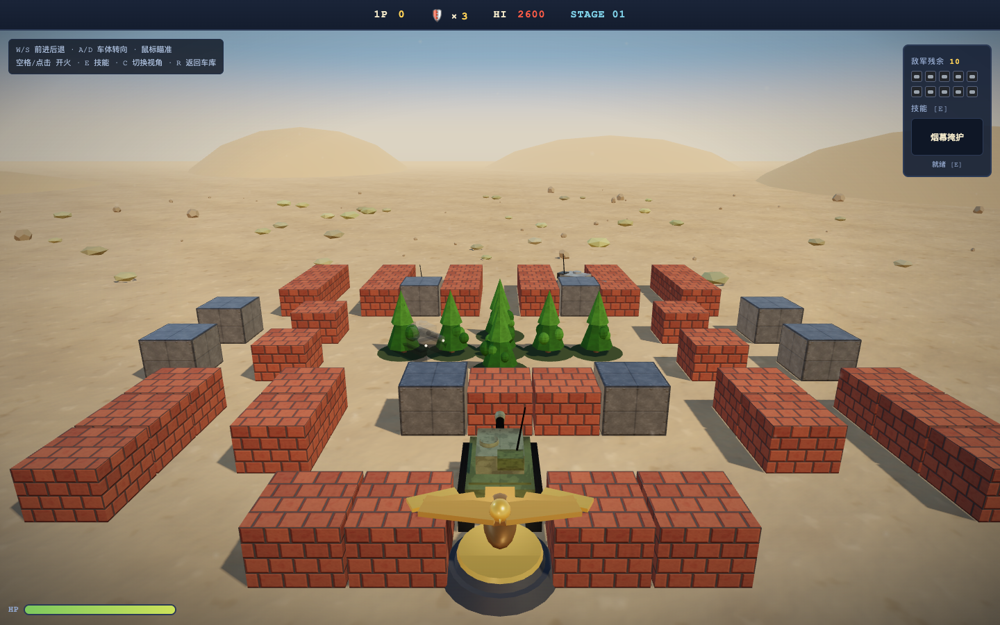

# 钢铁防线 3D · v1（初代单文件版）

最初的单文件可玩原型：**HTML + CSS + 一个 `<script type="module">`**，约 1685 行，
Three.js 通过 importmap 从本目录的 `vendor/` 加载。玩法、数值、关卡、模型工厂、
程序化贴图、HUD 全部写在 `index.html` 里。



> 这是**归档版本**，只修复阻塞性 bug，不再加新功能。后续开发在
> [`../v3/`](../v3/)；需要找回 v1 行为时用这里做对照。

---

## 运行

ES Module 需要 HTTP 服务，不能直接双击 `index.html`：

```bash
cd versions/v1
python3 -m http.server 4172
# 打开 http://127.0.0.1:4172/
```

或双击本目录的 `START-GAME.command`（端口 4172）。

需要支持 WebGL2 的浏览器。

---

## 操作

| 按键 | 动作 |
|---|---|
| W / S | 前进 / 后退 |
| A / D | 车体转向 |
| 鼠标 | 炮塔瞄准 |
| 空格 / 鼠标左键 | 开火 |
| E | 技能 |
| C | 切换视角 |
| R | 返回车库 |

守住底部鹰徽，消灭 3 波共 10 辆敌军；任何炮弹（包括自己的）命中鹰徽都会失败。

---

## 与后续版本的关系

| 版本 | 形态 | 状态 |
|---|---|---|
| v1 | 单文件 Demo，三辆程序化方块坦克 | 归档 |
| v2 | 分层架构 + M4A1 Sherman 模型/动画 | 冻结基线 |
| v3 | 从 v2 复制的迭代工作区 | **开发中** |

v1 的场景/材质重制对照图：`media/v1/before-after.png`。
