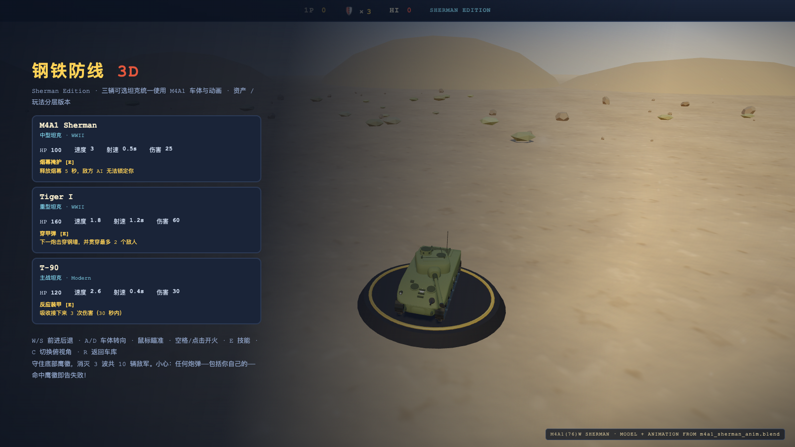
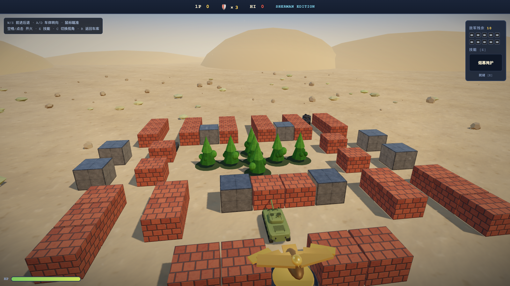
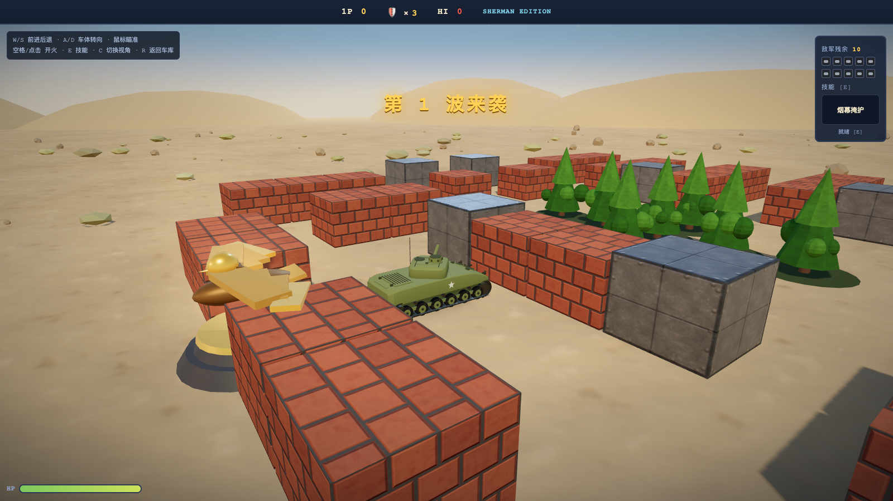

# 钢铁防线 3D · Sherman Edition（v2）

用 `assets/models/m4a1_sherman_anim.blend` 里的 **M4A1(76)W Sherman 建模 + 动画**替换原版
坦克，并按“资产 / 玩法分层”重做的全新版本。

> **原版没有改动。** `../v1/index.html` 仍是初代单文件版，可单独运行。
> 本版所有文件都在 `versions/v2/` 下，v3 从本版复制而来。



---

## 快速开始

ES Module + `.glb` 需要 HTTP 服务，不能直接双击 `index.html`：

```bash
cd versions/v2
python3 -m http.server 4173
# 打开 http://127.0.0.1:4173/
```

或：

```bash
cd versions/v2
npm start          # 等价于 python3 -m http.server 4173
```

需要支持 WebGL2 的浏览器（Chrome / Edge / Safari / Firefox 近年版本）。

---

## 操作

| 按键 | 动作 |
|---|---|
| W / S | 前进 / 后退 |
| A / D | 车体转向 |
| 鼠标 | 炮塔瞄准 |
| 空格 / 鼠标左键 | 开火（可按住连发） |
| E | 技能（烟幕 / 穿甲弹 / 反应装甲） |
| C | 追尾视角 ↔ 俯视视角 |
| R | 返回车库 |

玩法与原版一致：守住底部鹰徽，消灭 3 波共 10 辆敌军。**任何炮弹（包括你自己的）**
命中鹰徽都会失败。

---

## 这一版做了什么

### 1. 模型与动画替换

- 车体、炮塔、炮管、负重轮、履带全部来自 `m4a1_sherman_anim.blend`。
- 履带不是贴图滚动，而是 **146 节独立履带板**按原 blend 的 12.17 m 跑道循环滚动；
  负重轮 / 主动轮 / 诱导轮 / 托带轮同步转动。
- 炮塔由鼠标实时驱动；开火播放原 blend 的炮管后坐，炮口焰由引擎在炮口节点生成。
- 玩家用 `hero` 版（履带会滚）；敌人用 `troop` 版（履带合并，约 20 draw call/辆），
  保证 4 辆敌人同场仍然轻量。





### 2. 资产与机制分层

```
core（纯规则，无 THREE / DOM）  ←  content（数值/关卡/资产 ID）
        ↑ 语义事件
app（只做装配）  →  view（Three.js 表现）  ←  assets（GLB / rig / 贴图）
        ↑
platform（输入 / 音频 / 存档）
```

- 换模型只改 `src/content/assets.js` + 重新导出 GLB；
- 调数值只改 `src/content/`；
- 改 AI / 碰撞 / 胜负只改 `src/core/`；
- 改 HUD / 相机 / 爆炸只改 `src/view/`。
- `tests/core.test.mjs` 会自动检查 `core/` 没有 import Three.js、DOM 或资产层。

完整说明与契约见 **[docs/game-architecture.md](docs/game-architecture.md)**。

---

## 测试

```bash
cd versions/v2
npm test
```

当前 14 项全部通过，覆盖：

- **资产契约**：GLB hash、节点 tag（`Turret_Pivot` / `Gun_Pivot` / `GunMuzzle`）、
  `Drive` / `Fire` clip、动画 channel 目标、hero/troop LOD 差异；
- **规则**：碰撞、拆砖、敌人伤害、护盾、鹰徽失败、清波胜利、道具、同 seed 确定性；
- **分层约束**：`core/` 不依赖 Three.js/DOM/资产；`content/` 是纯数据。

浏览器冒烟（本次实际跑过）：车库选车、E 技能、R 返回、鼠标炮塔、W 前进（履带四元数
变化）、开火命中（敌人 HP 75→50）、炮击鹰徽进入结算。

---

## 目录

```
versions/v2/
├── index.html                页面外壳（HUD + importmap）
├── css/hud.css
├── src/
│   ├── main.js               启动与主循环
│   ├── app/game.js           一局编排
│   ├── core/                 玩法内核（纯 JS）
│   ├── content/              坦克/敌人/关卡/道具/资产清单
│   ├── assets/               GLB 加载、坦克 rig、程序化贴图
│   ├── view/                 场景/世界/坦克/炮弹/FX/相机/HUD
│   ├── platform/             输入/音频/存档
│   └── shared/               纯 PRNG
├── assets/models/            hero / troop GLB + manifest
├── tests/                    node:test
├── docs/game-architecture.md 分层与契约
└── preview/                  截图
```

---

## 重新生成模型

源文件：`../../assets/models/m4a1_sherman_anim.blend`

在**仓库根目录**运行：

```bash
SHERMAN_EXPORT_OUT="$PWD/versions/v2/assets/models" \
/Applications/Blender.app/Contents/MacOS/Blender -b -noaudio \
  --factory-startup --python tools/blender/export_game_sherman.py
```

> 导出脚本默认写 `versions/v3/assets/models`（当前迭代目标）；要更新 v2 快照时
> 才需要显式传 `SHERMAN_EXPORT_OUT`。

脚本会去掉演示用的车体位移和炮塔转角，把履带/轮子重烘成无缝 `Drive` 循环，把炮管
后坐拆成 `Fire`，再导出 hero / troop 两档 GLB 与同目录的 `manifest.json`。

细节见 [`assets/models/README.md`](assets/models/README.md)。

---

## 已知限制

- troop LOD 的履带是静态合并网格（远处敌人不滚履带）。
- 没有按距离自动切 LOD；玩家固定 hero，敌人固定 troop。
- 没有移动端触控、暂停菜单、存档进度。
- 模型约 1.1 万三角面，无 LOD 链、碰撞体或烘焙贴图。

下一步最小增量：给 troop 履带加 UV 滚动 / 着色器位移；把 hero 的 146 节履带板改成
InstancedMesh；补一轮人工试玩调炮塔转速、相机距离和履带滚速。

---

## 打不开？先看这里

这不是一个能直接双击 `index.html` 打开的项目：它用了 ES Module 和 `.glb` 资源，
浏览器会以 `file://` 的 CORS 限制拦掉，表现就是白屏/打不开。

正确打开方式（任选一种）：

1. **双击 `START-GAME.command`（启动游戏）**：自动起本地服务并打开浏览器；
2. 终端运行：
   ```bash
   cd versions/v2
   python3 -m http.server 4173
   ```
   然后访问 <http://127.0.0.1:4173/>。

> 注意：游戏地址是 `127.0.0.1:4173`，不是 DSH 界面的 `127.0.0.1:43120`。

## 部署到公网

`versions/v2/` 是纯静态站（无后端、无构建步骤）。把以下内容一起上传到任意静态托管即可：

```
index.html  css/  src/  assets/  vendor/
```

不要只上传 `index.html`；`src/`、`assets/`、`vendor/` 必须保持同样的相对路径。

已打包好的部署包：`../../releases/steel-bastion-sherman-v2.zip`。  
可以直接把压缩包拖到 Netlify Drop，或解压后放到 Vercel / GitHub Pages / nginx 的站点根目录。
入口文件是 `index.html`。
